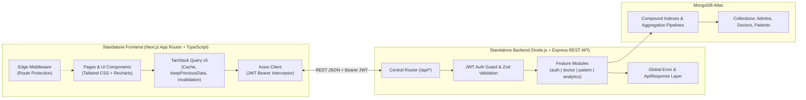
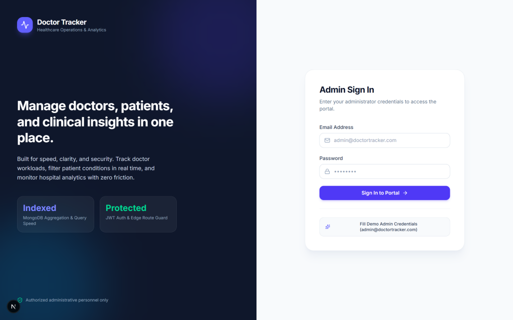
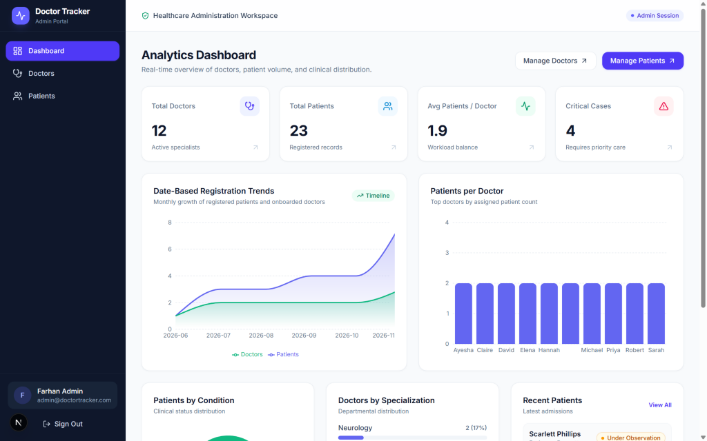
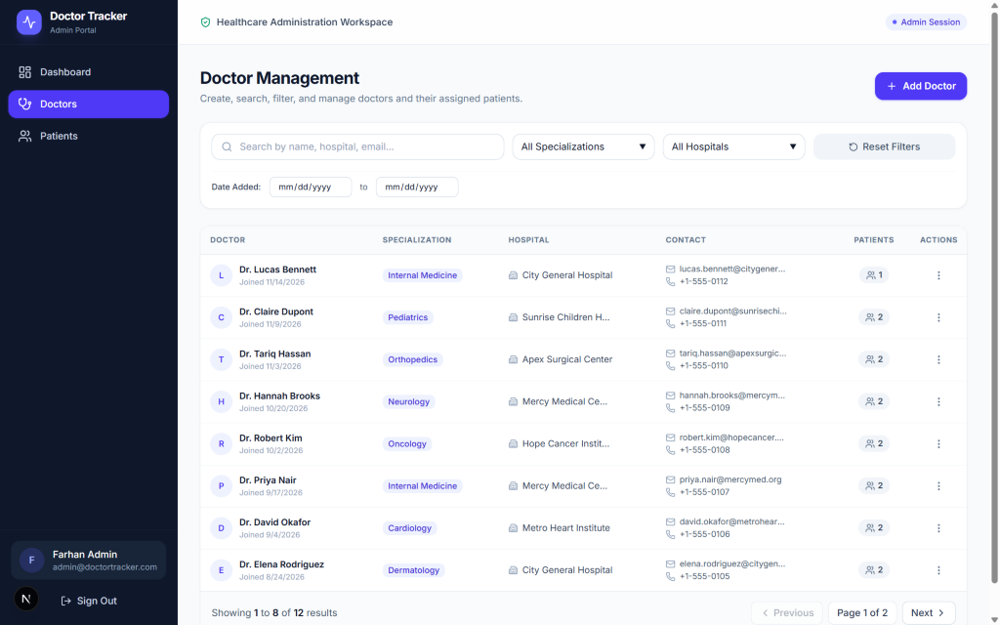
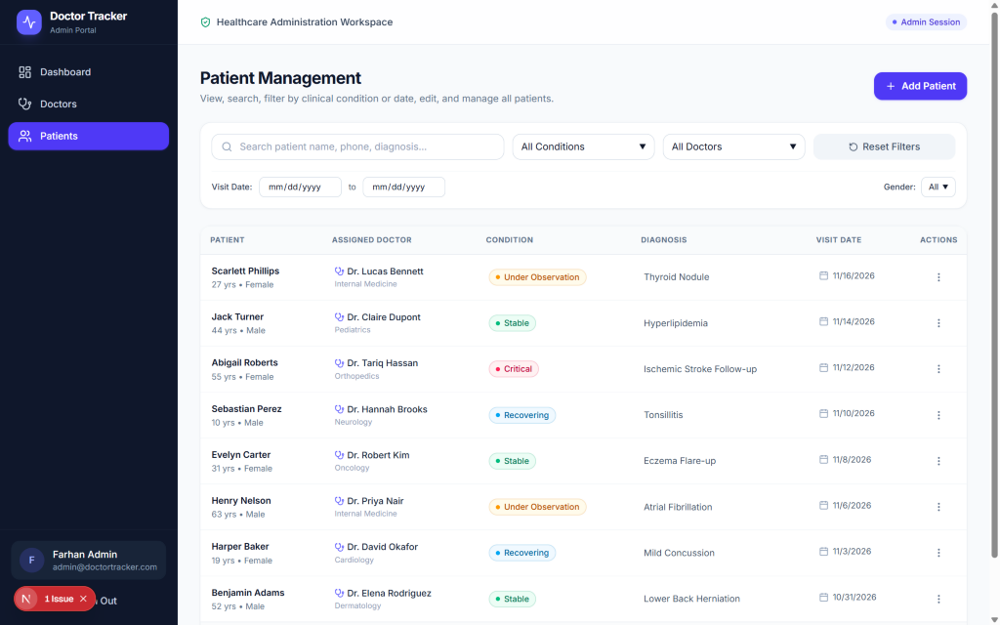
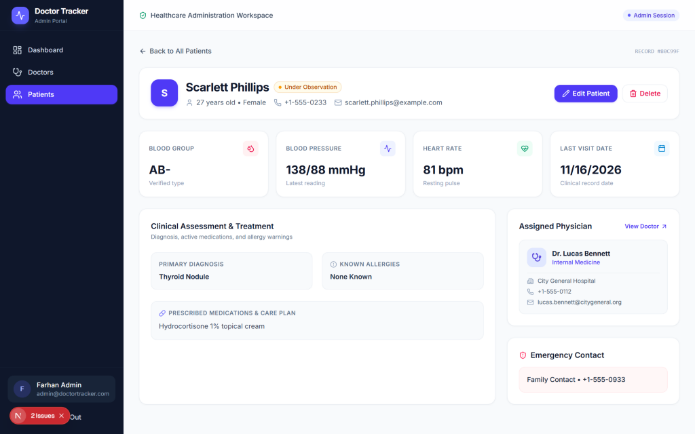
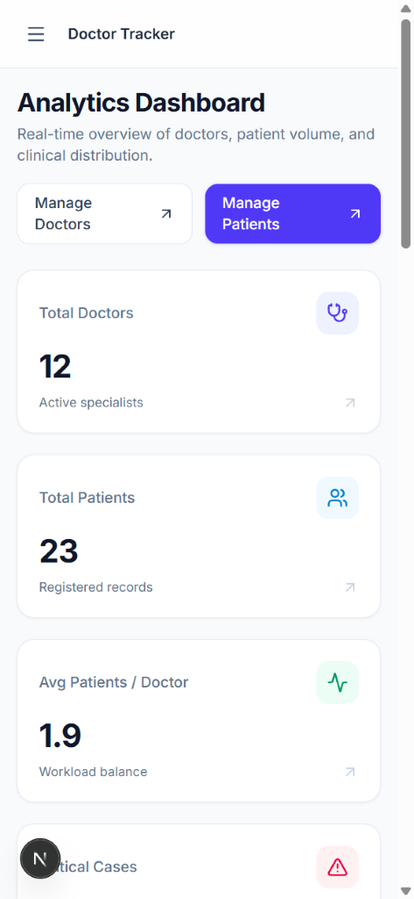
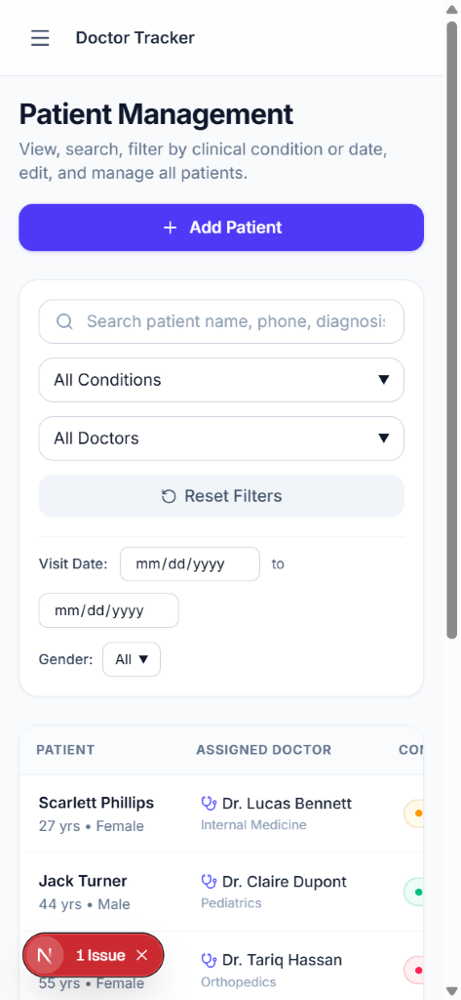

# Doctor Tracker — Healthcare Administrative Portal

> **Live Demo:** `[Add your deployed Vercel Frontend URL here]`  
> **Backend API:** `[Add your deployed Vercel Backend URL here]`  
> **Demo Admin Credentials:** `admin@doctortracker.com` / `Password123!`

---

## Description

**Doctor Tracker** is a secure, performance-optimized full-stack administrative web application built to help healthcare operations teams manage doctors, oversee patient clinical records, and monitor real-time hospital analytics from a single unified workspace. Designed with a standalone **Next.js (App Router, TypeScript)** client and a decoupled **Node.js + Express** REST API backed by **MongoDB Atlas**, it pairs indexed server-side search, multi-dimensional filtering, and aggregation pipelines with a clean, responsive, modern UI for effortless day-to-day clinical administration.

---

## Setup Guide

### Prerequisites
- **Node.js** `v18+` (tested on `v24.x`)
- **npm** `v9+`
- **MongoDB Atlas** cluster (or local MongoDB instance)

### 1. Clone the Repository
```bash
git clone https://github.com/FarhanBeacon/doctor-tracker.git
cd doctor-tracker
```

### 2. Configure & Run the Standalone Backend (`doctor-tracker-server`)
```bash
cd doctor-tracker-server
npm install
```

Create a `.env` file in `doctor-tracker-server/` based on [`doctor-tracker-server/.env.example`](doctor-tracker-server/.env.example):
```env
PORT=5000
MONGODB_URI=mongodb+srv://<db_username>:<db_password>@cluster0.xxxxx.mongodb.net/doctor-tracker?retryWrites=true&w=majority
JWT_SECRET=your_jwt_secret_key_here
JWT_EXPIRES_IN=7d
FRONTEND_URL=http://localhost:3000
```

Seed the database with the demo admin account, 12 doctors, and 24 patients (with vitals, diagnoses, and date distribution):
```bash
npm run seed
```

Start the Express API server:
```bash
npm run dev
```
The API will be live at `http://localhost:5000` (health check: `http://localhost:5000/api/health`).

### 3. Configure & Run the Standalone Frontend (`doctor-tracker-client`)
Open a second terminal from the project root:
```bash
cd doctor-tracker-client
npm install
```

Create a `.env.local` file in `doctor-tracker-client/` based on [`doctor-tracker-client/.env.example`](doctor-tracker-client/.env.example):
```env
NEXT_PUBLIC_API_URL=http://localhost:5000/api
```

Start the Next.js development server:
```bash
npm run dev
```
Open **`http://localhost:3000`** in your browser and sign in using the demo admin credentials (`admin@doctortracker.com` / `Password123!`).

---

## System Architecture

Doctor Tracker follows a strictly decoupled **Client–Server REST architecture** with modular domain separation on the backend and route-group separation on the frontend:



### Service & Data Flow Summary
1. **Authentication & Route Protection:** Next.js Middleware inspects the JWT cookie before serving `/dashboard`, `/doctors`, or `/patients`, redirecting unauthenticated visitors to `/login`. Every private Express route is independently verified via `Authorization: Bearer <token>` in `auth.middleware.js`.
2. **Modular REST API (`doctor-tracker-server`):** Organized by business domain (`src/modules/{auth, doctor, patient, analytics}`), cleanly separating HTTP controllers, business services, Mongoose models, and Zod validation schemas.
3. **Database Optimization:** MongoDB compound indexes (`{ specialization: 1, createdAt: -1 }`, `{ condition: 1, createdAt: -1 }`, `{ doctor: 1, createdAt: -1 }`, `{ visitDate: -1 }`) accelerate server-side search, filtering, and pagination, while analytics run in parallel via MongoDB Aggregation Pipelines.

---

## Technical Decisions

### 1. Why TanStack Query v5 + Debounced Search over React Context / Raw `useEffect`
- **Problem:** Administrative tables with live search, multi-filter dropdowns, date ranges, and pagination quickly suffer from race conditions, redundant API calls, loading flickers between pages, and manual cache staleness when managed via `useEffect` + `useState` or React Context.
- **Decision:** We adopted **TanStack Query v5** for all server state alongside a custom `useDebounce` hook (350ms) for search inputs, reserving React Context strictly for lightweight client auth state (`AuthProvider`).
- **Impact:**
  - `placeholderData: keepPreviousData` delivers **zero-flicker pagination and filtering**.
  - Keyed query invalidation (`['doctors']`, `['patients']`, `['dashboard-analytics']`) guarantees that creating, editing, or deleting a record immediately synchronizes KPI charts and tables without full-page reloads.
  - Debounced search inputs prevent unnecessary React re-renders and cut redundant database queries while typing.

### 2. Why MongoDB Aggregation Pipelines (`$lookup`, `$facet`, `$group`) + Compound Indexing over Application-Level Joins
- **Problem:** Displaying doctor lists with live `patientCount` badges and computing dashboard analytics (patients per doctor, condition distribution, monthly registration trends) via naive Mongoose queries causes the **N+1 query problem** and transfers excess documents over the network.
- **Decision:** We pushed aggregation directly into MongoDB using:
  - A single `$match` → `$lookup` → `$addFields` → `$facet` pipeline in `doctor.service.js` to return both paginated doctors with `patientCount` and total count in one database round-trip.
  - Parallel `Promise.all` aggregation pipelines in `analytics.service.js` (`$group` + `$dateToString`) for dashboard charts.
  - Strategic compound B-tree indexes on `{ specialization, createdAt }`, `{ condition, createdAt }`, `{ doctor, createdAt }`, and `{ visitDate }`.
- **Impact:** Keeps API latency consistently low even as doctor and patient collections scale, eliminates N+1 database calls, and minimizes payload size between MongoDB Atlas and the Express server.

---

## Visual Evidence

### Desktop Views (`1440×900`)

#### Admin Login Portal


#### Analytics Dashboard (KPIs & Recharts Visualizations)


#### Doctor Management (Search, Multi-Filters, Date Filter & Kebab Action Menu)


#### Patient Management (Condition, Doctor, Gender & Date Filtering)


#### Dedicated Patient Clinical Profile (`/patients/[id]`)


---

### Mobile Views (`390×844`)

| Mobile Dashboard | Mobile Patients |
| :---: | :---: |
|  |  |
